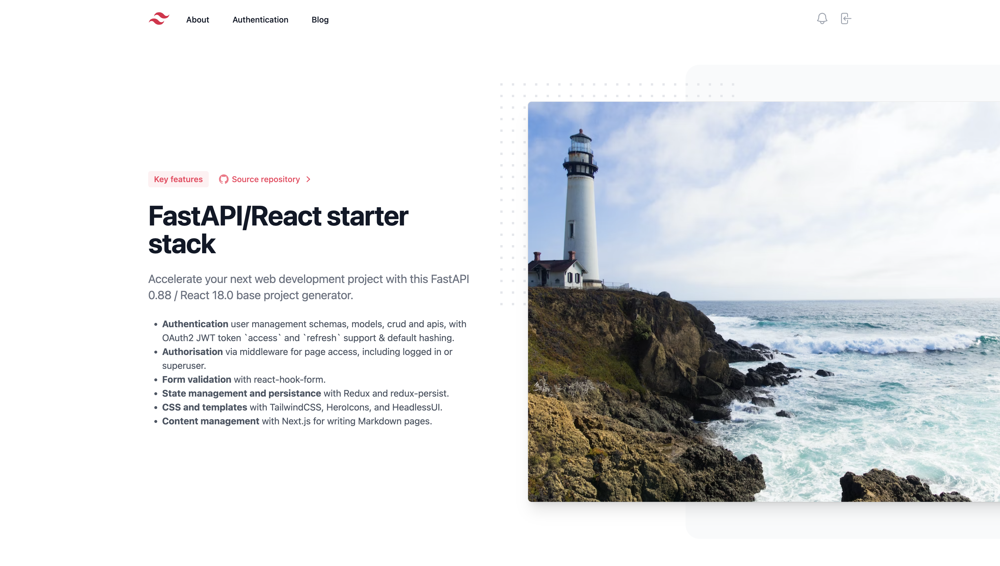

# Full Stack FastAPI, React, MongoDB (FARM) Base Project Generator

Show your love for this project by starring our repo :star2:, so we can continue to innovate :slightly_smiling_face:

Accelerate your next web development project with this FastAPI/React/MongoDB base project generator.

This project is for developers looking to build and maintain full-feature progressive web applications using Python on the backend / Typescript on the frontend, and want the complex-but-routine aspects of auth 'n auth, and component and deployment configuration, taken care of, including interactive API documentation. 

This is an **experimental** fork of [Sebastián Ramírez's](https://github.com/tiangolo) [Full Stack FastAPI and PostgreSQL Base Project Generator](https://github.com/tiangolo/full-stack-fastapi-postgresql) and [Whythawk's](https://github.com/whythawk) [Full Stack FastAPI and PostgreSQL Base Project Generator](https://github.com/whythawk/full-stack-fastapi-postgresql). FastAPI is updated to version 0.103.2, MongoDB Motor 3.4, ODMantic ODM 1.0.0, and the frontend to React.



## Index

- [Requirements](#requirements)
- [QuickStart](#quickstart)
- [Screenshots](#screenshots)
- [Key features](#key-features)
- [How to use it](#how-to-use-it)
  - [Building a generated app](./docs/getting-started.md)
  - [Development and installation](./docs/development-guide.md)
  - [Deployment for production](./docs/deployment-guide.md)
  - [Authentication and magic tokens](./docs/authentication-guide.md)
  - [Websockets for interactive communication](./docs/websocket-guide.md)
- [More details](#more-details)
- [Help needed](#help-needed)
- [Release notes](#release-notes)
- [License](#license)


## Requirements

Please make sure you have these installed before proceeding!
* [Docker Desktop](https://www.docker.com/products/docker-desktop/)
* [Python 3.11+](https://www.python.org/downloads/)
* [Cookiecutter](https://cookiecutter.readthedocs.io/en/stable/) -- The Python Cookiecutter library.
* [Hatch](https://hatch.pypa.io/latest/)
* [Node.js](https://nodejs.org/en)
* [MongoDB Compass](https://www.mongodb.com/products/tools/compass) -- To help visualize local/remote database easily.

## QuickStart

> **NOTE** This will generate a local application that is not yet production-ready. Please go through all of the README information linked before creating a version to deploy to a production host

For those that want to dive in and play around with the generated code, here's a quick start guide on how to do it. It is advised, though, once you have run through generating this app the first time, that you circle back and check out the more fleshed out [Building a generated app](./docs/getting-started.md) section. 

```
// Make sure cookiecutter and python are installed on the device
// This will generate a full-stack app in the directory ./example
cookiecutter https://github.com/mongodb-labs/full-stack-fastapi-mongodb --no-input project_name="example"

// Move into that directory.
cd example

// Make sure that you've opened the Docker Desktop app before this step.
// build
docker compose build --no-cache

// start the container in the background
docker compose up -d 
```

Now you can view the site by going to `localhost:3000`. You can also see all the logs of the running containers in your Docker Desktop app.

There will only be one user on the site: `admin@example.com`. If you choose a different project name, then the email domain changes.  For example, if you create your project using`project_name=fullstackexample` the user email will be `admin@fullstackexample.com`. The default password will be set to `changethis` but that can be changed. 

Here are all the local development URLS:

- Frontend -- http://localhost:3000
- Backend -- http://localhost/api/v1/
- Automatic Documentation via Swagger UI -- http://localhost/docs
- Alternative Documentation via ReDoc -- http://localhost/redoc
- Flower: Admin tool of Celery Tasks -- http://localhost:5555
- Traefik UI to see how routes are being handled by the proxy: http://localhost:8090

See [Building a generated app](./docs/getting-started.md) for examples of what these pages look like.


## Key features

This FastAPI, React, MongoDB repo will generate a complete web application stack as a foundation for your project development.

- **Docker Compose** integration and optimization for local development.
- **Authentication** user management schemas, models, crud and apis already built, with OAuth2 JWT token support & default hashing. Offers _magic link_ authentication, with password fallback, with cookie management, including `access` and `refresh` tokens.
- [**FastAPI**](https://github.com/tiangolo/fastapi) backend with [Inboard](https://inboard.bws.bio/) one-repo Docker images:
  - **PyMongo** https://pymongo.readthedocs.io/en/stable/
  - **Common CRUD** support via generic inheritance.
  - **Standards-based**: Based on (and fully compatible with) the open standards for APIs: [OpenAPI](https://github.com/OAI/OpenAPI-Specification) and [JSON Schema](http://json-schema.org/).
  - [**Many other features**]("https://fastapi.tiangolo.com/features/"): including automatic validation, serialization, interactive documentation, etc.
- [**Nextjs/React**](https://nextjs.org/) frontend:
  - **Authorization** route-based authentication, including support for detecting if a user is logged in or is a superuser.
  - **Form validation** with [React useForm](https://react-hook-form.com/docs/useform)
  - **State management** with [Redux](https://redux.js.org/)
  - **CSS and templates** with [TailwindCSS](https://tailwindcss.com/), [HeroIcons](https://heroicons.com/), and [HeadlessUI](https://headlessui.com/).
- **Celery** worker that can import and use models and code from the rest of the backend selectively.
- **Flower** for Celery jobs monitoring.
- Load balancing between frontend and backend with **Traefik**, so you can have both under the same domain, separated by path, but served by different containers.
- Traefik integration, including Let's Encrypt **HTTPS** certificates automatic generation.
- GitHub **CI** (continuous integration), including frontend and backend testing.

## How to use the template

- [Building a generated app](./docs/getting-started.md)
- [Development and installation](./docs/development-guide.md)
- [Deployment for production](./docs/deployment-guide.md)
- [Authentication and magic tokens](./docs/authentication-guide.md)
- [Websockets for interactive communication](./docs/websocket-guide.md)

## More details

After using this generator, your new project (the directory created) will contain an extensive `README.md` with instructions for development, deployment, etc. You can pre-read [the project `README.md` template here too](./{{cookiecutter.project_slug}}/README.md).

This current release is for FastAPI version 0.103 and introduces support for Pydantic 2. Since this is intended as a base stack on which you will build complex applications, there is no intention of backwards compatability between releases, and the objective is to ensure that each release has the latest long-term-support versions of the core libraries so that you can rely on your application core for as long as possible.

To align with [Inboard](https://inboard.bws.bio/), Poetry has been deprecated in favour of [Hatch](https://hatch.pypa.io/latest/). This will also, hopefully, sort out some Poetry-related Docker build errors.

## Help needed

This project is currently experimental, so bugs or issues may occur. Please open an issue ticket against this repository to make us aware of issues and we will do our best to respond to them in a timely manner. Please leave feedback on features that would be very beneficial for developers who often leverage MongoDB in their FastAPI stack.


## Release Notes

**NOTE: There is no intention to have backwards compatibility between releases.**

See notes: 

## Unreleased
- Upgraded Traefik from v2 to v3, starting from v3.7.13. The image now tracks the `traefik:v3` tag, so redeploying picks up new v3 minor and patch releases. Moving to v4 remains a deliberate, manual upgrade.
- Generated projects now include a `traefik.yml` stack file for the main public Traefik proxy. Previously this file was downloaded from DockerSwarm.rocks, but that file is pinned to Traefik v2 and can't be used with the v3 stack, so the template now ships its own.
- Updated docs/
  - Deployment guide now deploys the included `traefik.yml`

### Migrating an existing generated project from Traefik v2 to v3

Projects generated from earlier versions of this template don't pick up the change automatically. Apply it by hand:

1. **Add `traefik.yml`** to the root of your project. Copy it from [`{{cookiecutter.project_slug}}/traefik.yml`](./{{cookiecutter.project_slug}}/traefik.yml). It contains no cookiecutter variables, so you can copy it as-is. It replaces the `traefik.yml` you downloaded from DockerSwarm.rocks.

2. **Update `docker-compose.yml`.** In the `proxy` service, change the image and switch from the Docker provider in Swarm mode to the Swarm provider, which replaces it in Traefik v3:

   ```yaml
   # Before (Traefik v2)
   image: traefik:v2.2
   command:
     - --providers.docker
     - --providers.docker.constraints=Label(`traefik.constraint-label-stack`, `${TRAEFIK_TAG?Variable not set}`)
     - --providers.docker.exposedbydefault=false
     - --providers.docker.swarmmode

   # After (Traefik v3)
   image: traefik:v3
   command:
     - --providers.swarm
     - --providers.swarm.constraints=Label(`traefik.constraint-label-stack`, `${TRAEFIK_TAG?Variable not set}`)
     - --providers.swarm.exposedbydefault=false
     - --entrypoints.http.address=:80
     - --entrypoints.https.address=:443
   ```

   Then, in every service with Traefik labels (`proxy`, `flower` and any services you've added), rename the network label:

   ```yaml
   # Before
   - traefik.docker.network=${TRAEFIK_PUBLIC_NETWORK?Variable not set}
   # After
   - traefik.swarm.network=${TRAEFIK_PUBLIC_NETWORK?Variable not set}
   ```

3. **Update `docker-compose.override.yml`** (local development). Keep `--providers.docker`, because local development doesn't use Swarm. Replace the commented-out `# - --providers.docker.swarmmode` line with the `http` entrypoint:

   ```yaml
   - --entrypoints.http.address=:80
   ```

4. **Check locally** with `docker compose up -d`. The app should load as before, and the Traefik UI at http://localhost:8090 should list your routers.

5. **Upgrade the public proxy on your server before redeploying the app.** A v2 proxy doesn't read the `traefik.swarm.network` label. From your project directory, with `EMAIL`, `DOMAIN`, `USERNAME` and `HASHED_PASSWORD` exported as in the [deployment guide](./docs/deployment-guide.md#traefik-proxy-with-https), run:

   ```bash
   docker stack deploy -c traefik.yml traefik
   ```

   The existing `traefik-public` network, `traefik-public-certificates` volume and node label are reused, so your Let's Encrypt certificates carry over.

6. **Redeploy your app stack** with `scripts/build.sh` and `scripts/deploy.sh` as usual.

7. **Check production.** `docker stack ps traefik` should show the `traefik:v3` image, and `docker service logs traefik_traefik` should have no provider or label errors. Your site and the Traefik dashboard should load over HTTPS.

If you've added your own routers, rules or middlewares, also check them against Traefik's [v2 to v3 migration guide](https://doc.traefik.io/traefik/migration/v2-to-v3/). For example, the `HostRegexp` and `PathPrefix` rule syntax changed in v3.

### Forks of this template

Merge the update into your fork. If you've customised `{{cookiecutter.project_slug}}/docker-compose.yml` or `docker-compose.override.yml`, apply the changes from steps 2 and 3 above to your versions. Then generate a test project to confirm it builds and runs.

## CalVer 2024.01.10
- Replaced Beanie usage with ODMantic
- Fixed TOTP login
- Added Page-Level route authentication
- Fixed issued with logged in user being unable to access `/settings` page
- Throw errors on every non-ok auth.ts response
- Fixed Poject Named generation in Footer.tsx
- Removed unused CORS routes
- Updated README
  - Added QuickStart
  - Added Requirements
  - Added Container URL Information
- Updated docs/
  - Placed docker_example.png
  - Removed lingering Nuxt and Beanie references
  - Updated Indexing


## CalVer 2023.11.10

- Replaced Next/Vue.js frontend framework with entirely React/Redux
- Replaced Backend native connection of PostgreSQL/SQLAlchemy with MongoDB Motor/Beanie ODM
- Removed Neo4j plugin
- Removed Alembic Usage
- Introduced new cookiecutter environment variables `mongodb_uri`, and `mongo_database`
- Introduced support for Pydantic 2

[Historic changes from whythawk](https://github.com/whythawk/full-stack-fastapi-postgresql/releases)
[Historic changes from original](https://github.com/tiangolo/full-stack-fastapi-postgresql#release-notes)

## License

This project is licensed under the terms of the MIT license.
